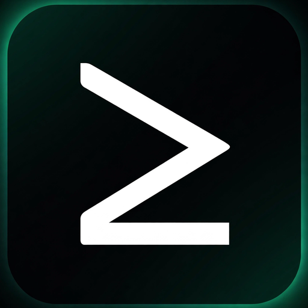

<p align="center">
  
</p>

<h1 align="center">Easy ADB</h1>

<p align="center">
  一个简单、轻量、中文友好的 Android 设备管理工具
</p>

<p align="center">
  <a href="https://easyadb.panchan.top/">官网</a>
  ·
  <a href="https://github.com/Panda2Chan/easy-adb/releases">下载</a>
  ·
  <a href="https://github.com/Panda2Chan/easy-adb/issues">问题反馈</a>
</p>

## Easy ADB 是什么

Easy ADB 是一款面向普通用户的 Android 设备管理工具。

它通过图形界面封装常用的 ADB 操作，帮助用户连接 Android 手机、电视和电视盒子，并完成 APK 安装。用户不需要记忆命令行参数，也不需要在多个终端窗口之间切换。

Easy ADB 支持 USB 连接、局域网连接和 Android 无线调试配对，适合日常调试、电视端应用安装、家庭设备管理和 Android 应用验收。

## 为什么做 Easy ADB

ADB 本身非常强大，但第一次使用时通常需要面对命令行、设备序列号、连接端口和安装参数。电视和电视盒子的安装场景还经常需要额外查找连接方式与设备地址。

很多用户实际只想完成几件事情：

- 找到设备
- 连接设备
- 选择一个 APK
- 安装到刚刚选中的设备

Easy ADB 希望把这些高频操作整理成清晰的桌面应用，让没有开发经验的用户也能完成常用的 ADB 任务。

## 项目优势

Easy ADB 的定位是让常用 ADB 操作更容易理解和上手。

### 更现代的桌面界面

使用 React、TypeScript 和 shadcn/ui 构建桌面界面，关注信息层级、操作路径和状态反馈，让设备连接和 APK 安装过程更容易理解。

### 功能更聚焦

项目围绕设备连接和 APK 安装展开，减少与核心任务无关的复杂选项，打开应用后可以快速找到下一步操作。

### 适合普通用户

用户可以通过设备列表选择目标设备，拖入本地 APK，或者粘贴 APK 下载地址。安装任务会使用点击安装时选定的设备，降低误装到其他设备的可能。

### 中文使用体验

界面提示、安装说明和常见问题以中文为主，适合中国大陆用户使用，也方便在中文社区中反馈问题和交流经验。

### 面向电视和电视盒子

除了 Android 手机，项目也关注 Android 电视和电视盒子的连接与安装场景，包括海信电视、小米电视盒子等设备。

具体兼容情况取决于设备型号、系统版本和固件是否开放对应的 ADB 能力。

## 主要功能

- 支持 Windows 和 macOS
- 支持 USB 连接 Android 设备
- 支持局域网地址连接
- 支持 Android 无线调试配对
- 支持 Android 手机、电视和电视盒子
- 支持拖拽或选择本地 APK
- 支持粘贴 HTTP(S) APK 下载地址
- 支持显示设备连接状态
- 支持选择目标设备后安装 APK
- Windows 安装包内置经过校验的 Android Platform-Tools
- 已有可用 ADB 时优先使用本机 ADB
- 支持中文界面和中文使用说明

## 下载

前往 [GitHub Releases](https://github.com/Panda2Chan/easy-adb/releases) 下载最新版本。

| 平台 | 安装包 | 说明 |
| --- | --- | --- |
| Windows x64 | `EasyADB-Setup-x64.exe` | 支持 Windows 10 2004 及以上版本 |
| macOS Universal | `easy-adb-mac-universal.zip` | 支持 Apple 芯片和 Intel |

官网提供统一的下载入口：

[https://easyadb.panchan.top/](https://easyadb.panchan.top/)

## 在 Windows 上启动

下载并运行 **EasyADB-Setup-x64.exe**。安装包已经内置经过 SHA256 校验的 Google 官方 platform-tools r36.0.2，安装阶段不会访问 Google，也不会因为电脑已有 ADB 而重复下载。应用启动时会优先使用 `EASY_ADB_PATH`、`PATH`、Android SDK 环境变量和 Android Studio SDK 中已有的 `adb.exe`，最后才使用安装包内置版本。需要时安装程序会从微软安装 WebView2，因此首次安装请保持微软服务可访问。完成后从开始菜单打开 **Easy ADB**，连接设备即可安装 APK。

应用安装到当前用户目录，支持 Windows 10 2004 及以上 x64 系统。Windows 安装包内置 Platform-Tools，不会因为电脑已有 ADB 而重复下载。

## 在 macOS 上启动

下载 `easy-adb-mac-universal.zip`，解压后运行安装脚本，或将 **Easy ADB.app** 拖入“应用程序”。当前 macOS 包使用临时签名，首次打开可能需要在 Finder 中右键选择“打开”。如果系统提示应用已损坏，可在终端执行：

```bash
xattr -dr com.apple.quarantine "/Applications/Easy ADB.app"
```

macOS 安装包支持 Apple 芯片和 Intel。首次启动时会优先使用系统已有的 `adb`，也可以在应用设置中指定 ADB 路径。

## 连接与安装

- **USB**　开启设备的 USB 调试，用支持数据传输的线连接。解锁设备并允许调试，设备会出现在列表中。
- **网络地址**　让电脑和设备处于可互通的局域网，在设备设置中开启网络 ADB，输入设备显示的 IP 和连接端口。
- **无线配对**　在支持无线调试的设备上打开“使用配对码配对设备”，输入配对地址和六位码。若配对后未自动上线，返回设备的无线调试主页，使用该页显示的连接端口。配对端口与连接端口可能不同。
- **安装**　选择在线设备。可拖入或选择一个 APK，也可粘贴 HTTP(S) APK 直链。下载上限 512 MiB。同一窗口重试相同链接时会复用已完成的下载。仅安装自己信任的来源。

## 兼容验证

首批真机目标为国行海信 85E7Q 和小米电视盒子。兼容情况取决于具体固件开放的 ADB 能力。两类设备当前均待实测。验收时记录型号和固件，并分别验证本地 APK、链接安装、目标选择和电视端启动。

项目目前处于持续开发和真机验收阶段。欢迎提交设备型号、系统版本、连接方式和问题日志，帮助完善兼容性说明。

## Star 趋势

如果 Easy ADB 对你有帮助，欢迎在 GitHub 点一个 Star。

[](https://www.star-history.com/#Panda2Chan/easy-adb&Date)

## 请我喝杯咖啡

Easy ADB 是一个开源项目。如果它帮你节省了时间，或者解决了 Android 设备连接和 APK 安装问题，欢迎请我喝杯咖啡。你的支持会用于服务器、测试设备和后续开发。

<p align="center">
  
  
</p>

<p align="center">感谢支持 Easy ADB 的持续开发。</p>

## 本地开发

界面使用 React、TypeScript、shadcn/ui 和 Vite。Windows 宿主通过 WebView2 加载本地资源。C# 核心库处理 ADB 子进程、下载、取消及缓存。

在 Windows 上准备 Node.js 22 和 .NET 10 SDK，从仓库根目录执行：

```powershell
cd ui
npm ci
npm test
npm run build
cd ..
dotnet test tests/EasyAdb.Tests.csproj
dotnet run --project src/EasyAdb.Windows
```

生成自包含的 x64 便携目录：

```powershell
dotnet publish src/EasyAdb.Windows -c Release -r win-x64 --self-contained true -o out
```

## 开源项目

仓库已公开，欢迎提交 Issue、改进建议和 Pull Request。
